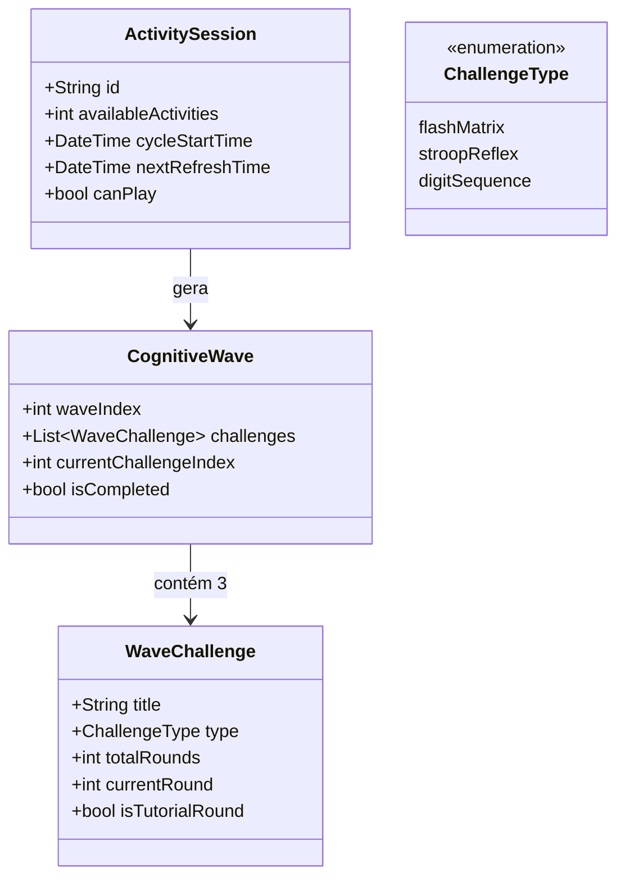

# Especificação da Funcionalidade: 5 Atividades em Ondas de 3 Desafios & Cadência de 5 Horas

## Identificador: `002-activity-waves-cadence`
**Status:** Aprovado  
**Data:** 05/11/2026  
**Metodologia:** Spec-Driven Development (SDD) & Scrum Slicing

---

## 1. Visão Geral do Produto
O jogador terá acesso a **5 atividades cognitivas por ciclo de 5 horas**.  
Cada atividade é estruturada como uma **Onda Cognitiva ("Cognitive Wave")** contendo **3 desafios distintos**.  
Cada desafio possui de **3 a 7 rodadas** com curva de dificuldade progressiva:
- **Rodada 1:** Fácil, com orientação visual e explicativa clara do objetivo.
- **Rodadas Subsequentes (2 a 7):** Aumento gradual de complexidade (tempo mais estrito, grids maiores, sequências mais longas, distratores visuais).

---

## 2. User Stories (Formato Scrum)

### US-01: Cadência de 5 Atividades a Cada 5 Horas
- **Como** usuário focado em treinamento cerebral,
- **Quero** ter até 5 atividades disponíveis a cada intervalo de 5 horas com um timer regressivo visível,
- **Para que** eu treine em sessões espaçadas sem sobrecarga cognitiva (anti-brain rot) e com motivação renovada.

**Critérios de Aceite:**
- [x] O usuário possui 5 tokens de atividade por ciclo.
- [x] Quando uma atividade é iniciada e concluída com sucesso, consome 1 token do lote atual.
- [x] Um temporizador regressivo (`04:59:59` ...) indica quando o próximo lote de 5 atividades será liberado.
- [x] Usuários VIP têm recarga instantânea ou cota expandida de atividades.

---

### US-02: Estrutura de Onda (Wave) com 3 Desafios Diferentes
- **Como** jogador buscando variedade neural,
- **Quero** que cada atividade seja uma onda com 3 desafios distintos em sequência,
- **Para que** eu exercite diferentes faculdades do córtex pré-frontal (Memória Espacial, Controle Inibitório e Memória Sequencial).

**Critérios de Aceite:**
- [x] A onda possui 3 fases de desafio encadeadas:
  1. **Desafio 1 - Flash Matrix:** Memória de trabalho visuoespacial (células iluminadas no grid).
  2. **Desafio 2 - Stroop Reflex:** Controle inibitório / Efeito Stroop (responder se a cor da tinta bate com o nome da cor sob pressão de tempo).
  3. **Desafio 3 - Digit Memory / Number Flash:** Sequência numérica rápida (reproduzir dígitos na ordem correta).
- [x] Ao completar o Desafio 1, transiciona automaticamente para o Desafio 2, e em seguida para o Desafio 3.
- [x] Ao concluir os 3 desafios, a atividade é finalizada e o resumo de XP é exibido.

---

### US-03: Dificuldade Progressiva (3 a 7 Rodadas por Desafio)
- **Como** jogador em evolução,
- **Quero** que cada desafio progrida de 3 a 7 rodadas com a primeira sendo explicativa e acessível,
- **Para que** eu aprenda a mecânica sem frustração e sinta o desafio aumentar à medida que meu cérebro acelera.

**Critérios de Aceite:**
- [x] O Desafio especifica sua quantidade de rodadas (configurável entre 3 e 7 rounds).
- [x] A **Rodada 1** exibe um banner/orientação clara ("Como Jogar" / Instrução rápida) e parâmetros facilitados (ex: grid menor, mais tempo de memorização).
- [x] Da **Rodada 2 em diante**, a dificuldade escala matematicamente:
  - Flash Matrix: Grid cresce (3x3 -> 4x4 -> 5x5) e número de alvos aumenta (3 -> 5 -> 7).
  - Stroop Reflex: O tempo por estímulo cai de 2.5s para 1.0s, com cores incongruentes.
  - Digit Memory: A quantidade de dígitos exibidos cresce de 3 até 7 números.
- [x] O jogador pode errar até um limite de tolerância (ou reiniciar a rodada atual) antes de falhar a onda.

---

## 3. Modelo de Dados Conceitual

---

## 4. Requisitos Não Funcionais
- **Performance:** Troca fluida entre rodadas e desafios sem re-renders desnecessários.
- **Feedback Visual Neuroergonômico:** Uso da paleta definida (Ciano `#00D2FF`, Menta `#00E599`, Âmbar `#FFFF9F1C`, Ardósia `#0A0F1D`).
- **Simplicidade (Ponytail):** Componentes concisos de jogos reutilizando widgets padrão do Flutter sem dependências adicionais de game engines pesadas.
