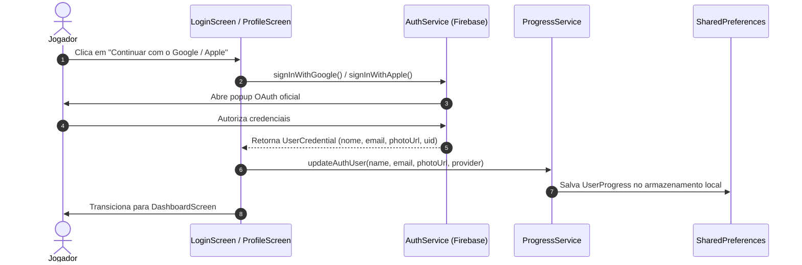

# Especificação da Funcionalidade: Autenticação Real com Firebase (Google & Apple/iCloud)

## Identificador: `003-auth-firebase-google-apple`
**Status:** Aprovado  
**Data:** 05/11/2026  
**Metodologia:** Spec-Driven Development (SDD) & Scrum Slicing

---

## 1. Visão Geral do Produto
O jogador poderá autenticar-se utilizando sua conta **Google** ou **Apple / iCloud** através do **Firebase Authentication**, sincronizando seu nome, e-mail, foto de perfil e mantendo seu progresso em nuvem entre dispositivos (Web, iOS, Android).

Para manter máxima resiliência e não quebrar testes unitários ou execuções locais sem chaves de API, o sistema adota um padrão híbrido:
- Se as credenciais do Firebase estiverem configuradas, executa o popup real do Google/Apple OAuth.
- Se for ambiente de desenvolvimento, teste ou se o usuário optar pelo modo Convidado (Guest), permite o acesso instantâneo preservando a experiência.

---

## 2. User Stories (Formato Scrum)

### US-01: Autenticação com Google via Firebase Auth
- **Como** jogador,
- **Quero** clicar em "Continuar com o Google" e realizar login através da minha conta Google,
- **Para que** meu perfil, avatar e progresso fiquem vinculados ao meu e-mail Google com segurança.

**Critérios de Aceite:**
- [x] O botão "Continuar com o Google" aciona o provedor `GoogleAuthProvider` via Firebase.
- [x] Ao concluir a autenticação com sucesso, os campos `userName`, `userEmail`, `userPhotoUrl` e `authProvider = 'google'` são preenchidos no perfil do usuário.
- [x] O usuário é redirecionado para o painel principal (`DashboardScreen`).
- [x] Tratamento de cancelamento/erro pelo usuário com mensagem informativa (SnackBar).

---

### US-02: Autenticação com Apple / iCloud via Firebase Auth
- **Como** usuário do ecossistema Apple,
- **Quero** clicar em "Continuar com Apple / iCloud" e fazer login seguro com minha Apple ID,
- **Para que** eu jogue no Mac, iPhone ou navegador com a mesma identidade.

**Critérios de Aceite:**
- [x] O botão "Continuar com Apple / iCloud" aciona `OAuthProvider('apple.com')` via Firebase.
- [x] Os dados de usuário são sincronizados com `authProvider = 'apple'`.
- [x] Tratamento de erros e redirecionamento para o dashboard.

---

### US-03: Persistência de Sessão e Logout Limpo
- **Como** jogador frequente,
- **Quero** permanecer autenticado após fechar a aba do navegador,
- **Para que** eu não precise fazer login novamente a cada treino cognitivo.

**Critérios de Aceite:**
- [x] O estado de login persiste no `SharedPreferences` e no estado do `FirebaseAuth`.
- [x] Botão de "Sair da Conta" no `ProfileScreen` encerra a sessão no Firebase e no app, retornando à tela de Login.
- [x] Fallback de Modo Convidado (Guest) mantido para testes rápidos sem fricção.

---

## 3. Modelo de Dados & Arquitetura

